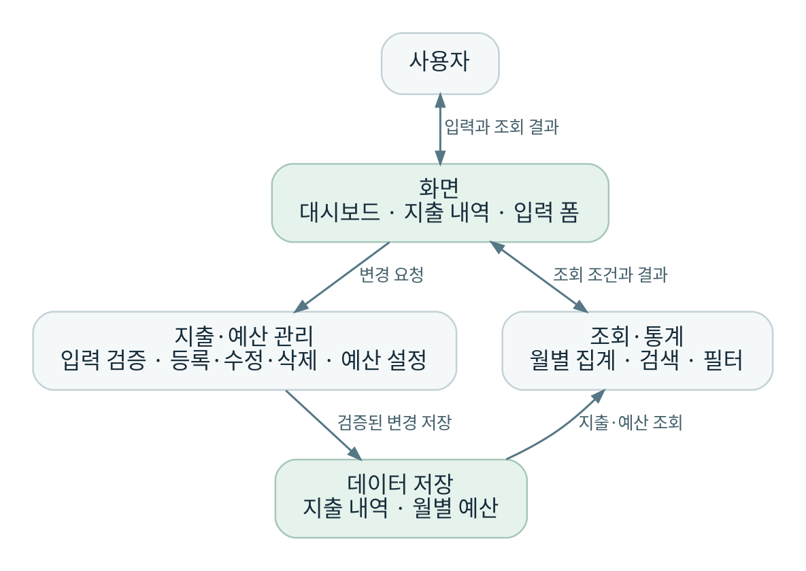
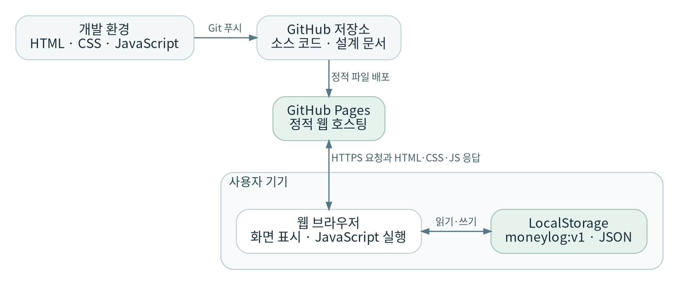

# MoneyLog 기획 및 설계

대림대학교 전공심화(1년)과정 · 실무프로젝트2 기말프로젝트

## 1. 프로젝트 기획

MoneyLog는 개인이 일상 지출을 기록하고, 월별 총지출과 카테고리별 소비 패턴을 확인해 예산을 관리하는 웹사이트다. 식비, 교통비, 쇼핑처럼 여러 곳에서 발생하는 지출을 모아 보면 어떤 항목부터 소비를 줄일지 판단할 수 있다.

- **대상 사용자** · 식비나 교통비 등 일상 지출을 직접 기록하고 월 단위로 관리하려는 개인
- **완료 기준** · 지출 등록·수정·삭제, 월별 총지출, 카테고리별 통계, 월 예산 설정과 잔여액, 검색·필터 기능이 GitHub Pages 배포 환경에서 동작한다.
- **기술 구성** · HTML과 CSS로 반응형 화면을 구성하고 JavaScript로 입력 검증, 집계, 렌더링을 처리한다. 서버 없이 LocalStorage로 기록과 예산을 저장하고, GitHub로 버전을 관리하며 GitHub Pages로 정적 배포한다.
- **사용 조건** · 한 사람의 원화 지출을 기준으로 한다. 기록과 예산은 같은 브라우저 프로필과 사이트 주소에서 다시 열 수 있다. 브라우저 저장 데이터를 지우면 기록이 사라진다.

## 2. 요구사항

| 기능 | 동작 및 완료 기준 |
|---|---|
| 지출 등록 | 날짜, 지출명, 카테고리, 금액은 필수다. 메모는 선택이다. 금액은 1원 이상의 정수로 입력한다. |
| 지출 수정·삭제 | 수정 폼에 기존 값을 채운다. 삭제 전에 대상 지출명을 표시하고 확인받는다. 처리 후 목록과 월 요약을 갱신한다. |
| 월별 소비 금액 | 첫 방문 시 이번 달을 보여준다. 월을 바꾸면 해당 월의 지출 합계, 목록, 통계, 예산을 조회한다. |
| 카테고리별 통계 | 항목별 지출액과 해당 월 총지출 대비 비중을 가로 막대와 숫자로 보여준다. 지출이 없는 달에는 빈 상태를 표시한다. |
| 예산 설정 | 선택한 월마다 총예산 하나를 저장한다. 1원 이상의 정수를 입력한다. 미설정 상태에는 ‘예산 설정’을 표시한다. |
| 잔여 예산 확인 | 예산에서 해당 월 총지출을 뺀다. 잔여액이 0원이면 ‘예산 소진’, 음수면 ‘초과’와 초과 금액을 표시한다. |
| 검색·필터 | 선택한 월의 지출명과 메모를 키워드로 검색하고, 카테고리와 함께 적용할 수 있다. 결과는 날짜 내림차순으로 표시한다. |
| 저장 오류 | LocalStorage 읽기나 쓰기에 실패하면 오류를 표시한다. 쓰기 실패 시 폼 값을 유지하고 기존 화면의 집계값을 보존한다. |

## 3. 화면 및 사용 흐름

| 화면 | 주요 요소와 행동 |
|---|---|
| 월간 대시보드 | 월 선택, 총지출·예산·잔여액, 예산 사용률, 카테고리 통계, 최근 지출과 등록 버튼 |
| 지출 내역 | 월 선택, 검색, 카테고리 필터, 금액과 날짜, 행별 수정·삭제. 모바일에서는 각 지출과 작업 버튼을 줄바꿈해 표시한다. |
| 지출 등록·수정 | 공용 폼에서 날짜·지출명·카테고리·금액·메모를 입력한다. 등록일은 선택한 달이 현재 달이면 오늘, 과거 또는 미래의 달이면 그 달의 1일을 기본으로 한다. |
| 예산 설정 | 선택한 월을 보여주고 월 예산을 입력하거나 수정한다. 저장하면 잔여액을 즉시 다시 계산한다. |

**기본 흐름** · 월 선택 → 요약 확인 → 지출 등록 또는 내역 검색 → 저장 → 월 요약 갱신

**날짜 변경** · 지출의 날짜를 다른 달로 수정하면 기록은 새로운 달의 집계로 이동한다. 저장 직후 이동한 월을 보여줘 기록을 바로 확인할 수 있게 한다.

**집계 범위** · 월 선택은 전체 화면에 적용한다. 검색어와 카테고리 필터는 목록에만 적용한다.

**빈 화면** · 월에 기록이 없으면 등록 버튼을 표시한다. 검색 결과만 비었으면 검색어나 필터를 바꿀 수 있게 안내한다.

## 4. 데이터와 처리 규칙

LocalStorage 키는 `moneylog:v1`이다. 초기 데이터는 지출 목록과 예산이 모두 비어 있는 버전 1 객체다.

```json
{
  "version": 1,
  "expenses": [
    {
      "id": "65978973-8a38-4c1a-8b2d-e6cbb2e623d3",
      "date": "2026-11-18",
      "title": "점심 식사",
      "category": "food",
      "amount": 12500,
      "memo": "학교 근처"
    }
  ],
  "budgets": {
    "2026-11": 500000
  }
}
```

- **카테고리** · 식비(`food`), 교통(`transport`), 쇼핑(`shopping`), 생활(`daily`), 기타(`other`).
- **지출 ID** · 새 기록마다 `crypto.randomUUID()`로 생성하고 수정할 때 유지한다.
- **날짜** · 입력한 날짜를 `YYYY-MM-DD` 문자열로 보관한다. 문자열 앞의 `YYYY-MM`을 사용해 월에 묶는다.
- **금액** · 원 단위의 양의 안전 정수로 검증한다. 표시에는 `Intl.NumberFormat('ko-KR')`를 사용한다.
- **집계** · 월 총지출은 해당 월 금액 합계다. 카테고리 비중은 해당 카테고리 합계를 총지출로 나눈 값이다. 예산 사용률은 총지출을 예산으로 나눈 값이다. 100%를 넘으면 막대는 가득 채우고 실제 비율과 초과 금액을 함께 표시한다.
- **화면 갱신** · 폼 검증 → 변경된 데이터 저장 → 저장 성공 시 화면 상태 반영 → 목록 및 집계 갱신 순으로 처리한다.
- **저장 복구** · 저장 내용이 손상되어 읽을 수 없으면 오류를 표시하고 기존 값을 자동으로 덮어쓰지 않는다. 값이 없는 최초 접속만 빈 상태로 시작한다.
- **구현 구조** · `index.html`에 화면 구조를, `css/style.css`에 스타일을 둔다. `js/app.js`는 화면과 이벤트를, `js/storage.js`는 저장을, `js/summary.js`는 합계와 목록 필터를 맡는다. GitHub Pages의 프로젝트 경로에서 동작하도록 정적 파일을 상대 경로로 불러온다.

## 5. 목업 비교

| 안 | 첫 화면에서 가장 잘 보이는 것 | 주요 사용 흐름 |
|---|---|---|
| 대시보드형 | 총지출, 월 예산, 잔여액과 카테고리 비중 | 요약에서 이번 달 상태를 확인하고 최근 내역으로 이동한다. |
| 기록장형 | 검색, 카테고리 필터, 지출 목록 | 여러 건을 찾거나 수정·삭제하는 작업을 한 화면에서 이어간다. |
| 예산 중심형 | 잔여 예산, 사용률, 예산 수정 | 지출하기 전에 남은 금액부터 확인한 뒤 상세 내역을 펼친다. |

### 확정 디자인 · 1안 대시보드형

- 상단에 조회 월과 ‘지출 등록’ 버튼을 배치한다.
- 월간 요약에 총지출, 월 예산, 잔여 예산과 예산 사용률을 표시한다.
- 요약 아래에 카테고리별 지출과 최근 지출을 나란히 배치하고, 좁은 화면에서는 위아래로 배치한다.
- 최근 지출에서 전체 내역으로 이동한다. 전체 내역 화면에서 검색, 카테고리 필터, 수정 및 삭제를 제공한다.

## 6. 논리 구성도



| 구성 요소 | 담당 기능 |
|---|---|
| 화면 | 대시보드, 지출 내역 목록, 지출 등록·수정 폼, 예산 설정 폼을 제공한다. |
| 지출·예산 관리 | 입력값을 검증한 뒤 지출을 등록·수정·삭제하거나 선택한 월의 예산을 저장한다. |
| 조회·통계 | 선택 월의 총지출, 카테고리별 지출, 예산 사용률과 잔여액을 계산한다. 검색과 카테고리 필터는 목록에 적용한다. |
| 데이터 저장 | 지출 내역과 월별 예산을 읽고, 검증된 변경 내용을 저장한다. |

지출은 고유 ID로 식별하며, 지출 날짜의 연·월을 기준으로 해당 월에 포함한다. 한 달에는 지출이 0건 이상 들어가며 예산은 0개 또는 1개다. 카테고리는 지출 한 건당 하나를 선택한다. 총지출과 잔여액은 지출과 예산을 바탕으로 조회할 때 계산한다.

## 7. 물리 구성도



| 배치 위치 | 구성 및 역할 |
|---|---|
| 개발 환경 | HTML, CSS, JavaScript를 작성하고 Git으로 변경 이력을 관리한다. |
| GitHub 저장소 | 소스 코드와 설계 문서를 보관한다. 작업 단계가 끝나면 변경 사항을 커밋하고 푸시한다. |
| GitHub Pages | 저장소의 HTML, CSS, JavaScript 정적 파일을 HTTPS로 제공한다. |
| 사용자 기기의 브라우저 | 화면을 렌더링하고 입력 검증, 지출 조회, 예산 집계를 실행한다. |
| 브라우저 LocalStorage | `moneylog:v1` 키 하나에 버전, 지출 내역 배열, 월별 예산 객체를 JSON 문자열로 저장한다. |

브라우저는 HTTPS로 정적 파일을 받아 실행한다. 사용자의 지출과 예산은 브라우저에서만 읽고 쓰며, 저장 범위는 브라우저 프로필과 사이트 출처(프로토콜·호스트·포트)로 구분된다. GitHub Pages가 웹 파일을 제공하고, 데이터 처리는 사용자 브라우저에서 이루어진다.

### 물리 저장 구조

| 저장 위치 | 자료형 | 내용 |
|---|---|---|
| `moneylog:v1` | JSON 문자열 | 저장 데이터 전체를 담는 LocalStorage 항목 |
| `version` | 정수 | 데이터 형식 버전. 초기값은 `1` |
| `expenses[]` | 객체 배열 | ID, 지출일, 지출명, 카테고리, 금액, 메모로 구성된 지출 기록 |
| `budgets[YYYY-MM]` | 정수 | 월 키에 대응하는 원 단위 예산. 키가 없으면 예산 미설정 |
